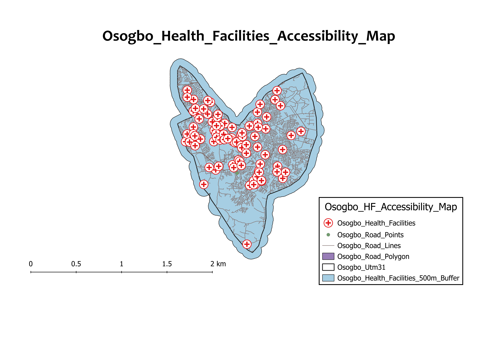

# geodev-lab-project
GIS spatial accessibility analysis of health facilities, road networks coverage in Osogbo LGA, Osun State.

## What's in here

```
<project-name>/
├── Month-1/
├── docs/
│   ├── 01-project-brief.md      Week 1
│   ├── 02-data-notes.md         Week 2
│   ├── 03-CRS, Reprojection and Area Calculation.md   Week 3
│   ├── 04-Analysis-&-Results.md  Week 4
│   └── Health_Facilities_Accessibility_Map.png
│   ├── month-1-summary.md

├── data/           
│   └── processed/               
│   ├── roads.gpkg
│   ├── wards.gpkg
├── raw/
├── lga_facilities/
│   ├── health_facilities.csv
│   ├── ward_population.csv

├── Month-3/
├── week-10
├── week-11
├── Week-12

├── screenshots/
│   └── Week5.png
│   └── check.py.png
│   └── week7.png
│   └── week8.png
│   └── week9.png

├── src/geodev_lab_project
│    ├── .gitignore

│   ├── hello.py      Week 5
│   ├── check.py      Week 6
│   ├── project.toml  Week 6
│   ├── uv.lock       Week 6
│   ├── analyse.py    Week 7
│   ├── wards.csv     Week 7
│   ├── mydata.csv    Week 8
│   ├── inspect_data.py     Week 8
│   ├── summary.py     Week 9
│   ├── uv.lock
│   └── wards.csv
```
The data is not in this repository. Every source is linked in
[the project brief](/Month-1/docs/01-project-brief.md).




## Progress

## Month 1: GIS Foundations And Data Ecosystem
- [x] Week 1, project brief with a source link for every dataset
- [x] Week 2, data downloaded, opened and described
- [x] Week 3, reprojected, clipped and quality checked
- [x] Week 4, first spatial analysis, checked four ways

## Month 2: Development Environment And Early Python
- [x] Week 5, set up python, VS code and the terminal. Hello.py runs [week 5](hello.py)
- [x] Week 6, Environments and project setup with uv [week 6](check.py)
- [x] Week 7, Python, the six ideas [week 7](analyse.py)
- [x] Week 8, Python, files and data : Completed inspect_data.py to summarize GIS spatial accessibility analysis data for Osogbo LGA, Osun State, focusing on the area_wrong and area_km2 fields. [week 8](inspect_data.py)
- [x] week 9, Consolidation and refactoring : This week, I learned how to refactor my Python code by breaking a program into smaller, reusable functions. I created separate functions to read CSV data, clean numerical values, and calculate summary statistics such as count, smallest value, largest value, and average. This practical strengthened my understanding of writing clean, reusable code and showed me how Python can support geospatial data analysis and future GIS automation tasks. [week 9](summary.py)
      
## Month 2 Key Lessons:
- Breaking a program into smaller functions
- Reading and processing CSV datasets using Python
- Cleaning numerical values before analysis
- Using loops and dictionaries to summarise multiple columns
- Improving code readability without changing existing behaviour.

## Month 3: Geospatial Python And Automation
- [x] **Week 10, Geopandas, layers as tables** [week-10 files](month-03/week-10)
### week-10-my_notes

[`my_explore.py`](month-03/week-10/my_explore.py) was used to inspect the Osogbo_Road_Lines GeoPackage, examine its attributes, geometry types, CRS, and spatial extent.
**Results:**
- **Total features:** 3,747
- **Columns:** 25
- **Geometry type:** MultiLineString (3,747)
- **CRS:** EPSG:32631
- **Spatial bounds:** Min X: 668098.95, Min Y: 850807.03, Max X: 677309.46, Max Y: 863086.26

[`my_points.py`](month-03/week-10/my_points.py) was used to read the health facilities CSV file, convert longitude and latitude coordinates into spatial Point geometries, and save the data as a GeoPackage
**Results:**
- **Total facilities:** 91

[`my_join.py`](month-03/week-10/my_join.py) was used to assess the proximity of health facilities to the road network by calculating the nearest road distance for each facility.
**Results:**
- Health facilities: 91, Road features: 3,747, Total road length: 674.74 km, CRS: EPSG:32631
- Nearest road distance: Calculated for each health facility in metres and the first five facilities recorded distances of 8.36 m, 8.75 m, 29.72 m, 6.49 m, and 20.05 m respectively.

[`my_map.py`](month-03/week-10/my_map.py) was used to visualise the road network and health facility locations on a single map, ensuring both layers share the same CRS.
**Output:**
- Saves the map as facilities_map.png in [month-03](month-03/week-10/).

- [x] **Week 11, Coordinate Reference Systems and Spatial Operations in Code** [week-11 files](month-03/week-11)
### week-11-my_notes
[`my_crs.py`](month-03/week-11/my_crs.py) was used to estimate the appropriate UTM CRS, reproject the road network, and calculate individual and total road lengths in kilometres.

**Results:**
- Estimated UTM CRS: EPSG:32631, Total road length: 674.74 km, First road feature length: 0.326 km
  
[`my_count.py`](month-03/week-11/my_count.py) was used to perform a spatial join between health facilities and road polygons, counting the number of facilities within each polygon.

**Results:** Road polygons: 3,747, Health facilities: 91, Facilities counted: 0

[`my_validity.py`](month-03/week-11/my_validity.py) was used to check the road network for invalid geometries and repair them using make_valid().

**Results:** 

[`my_reach.py`](month-03/week-11/my_reach.py) was used to calculate the distance from each road feature to its nearest health facility using a spatial nearest join.
**Results:** 


- [x] **Week 12, Rasters and Rasterio** [week-12 files](month-03/week-12)
## week-12-my_notes
[`my_inspect.py`](month-03/week-12/my_inspect.py)was used to inspect the Digital Elevation Model (DEM) raster and retrieve its spatial and technical metadata.
**Results:** 

[`my_index.py`](month-03/week-12/my_index.py)
**Results:** 


[`my_zonal.py`](month-03/week-12/my_zonal.py) was used to calculate the mean elevation and NDVI values within 500-metre buffers around each road feature.
**Results:** 


[`my_plot_ndvi.py`](month-03/week-12/my_plot_ndvi.py)
**Output:**
- Saves the map as ndvi_map.png in [month-03](month-03/week-12/).

---


#  Author
Emmazy_Jr
